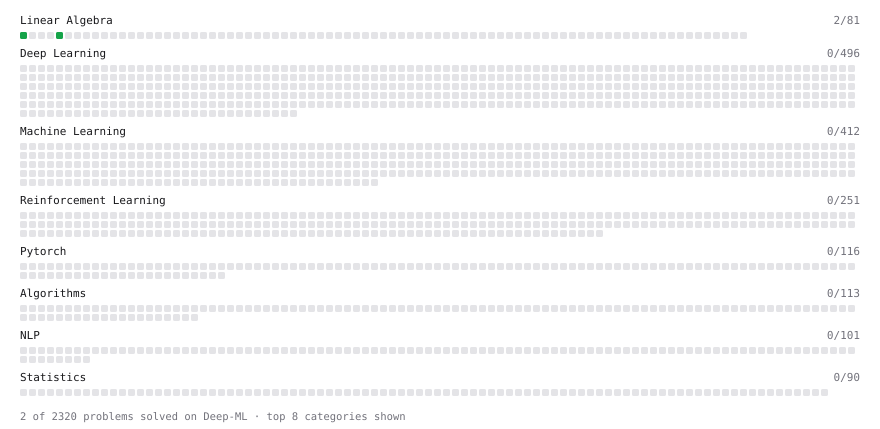

# Deep-ML

My machine learning practice from [Deep-ML](https://www.deep-ml.com). Every solution here was written by hand.

**4** solved · 4 problems · 0 labs · 0 math

[**Browse the interactive portfolio**](https://kacp3rrr.github.io/deep-ml/) to replay this filling in over time.

## Problems

| | Difficulty | Solved | |
| --- | --- | --- | --- |
| [Convert Vector to Diagonal Matrix](https://www.deep-ml.com/problems/35) | easy | 2026-11-16 | [solution](problems/0035-convert-vector-to-diagonal-matrix) |
| [Linear Kernel Function](https://www.deep-ml.com/problems/45) | easy | 2026-11-16 | [solution](problems/0045-linear-kernel-function) |
| [Matrix-Vector Dot Product](https://www.deep-ml.com/problems/1) | easy | 2026-11-16 | [solution](problems/0001-matrix-vector-dot-product) |
| [Scalar Multiplication of a Matrix](https://www.deep-ml.com/problems/5) | easy | 2026-11-16 | [solution](problems/0005-scalar-multiplication-of-a-matrix) |

---

_This file is regenerated by Deep-ML on every push._
